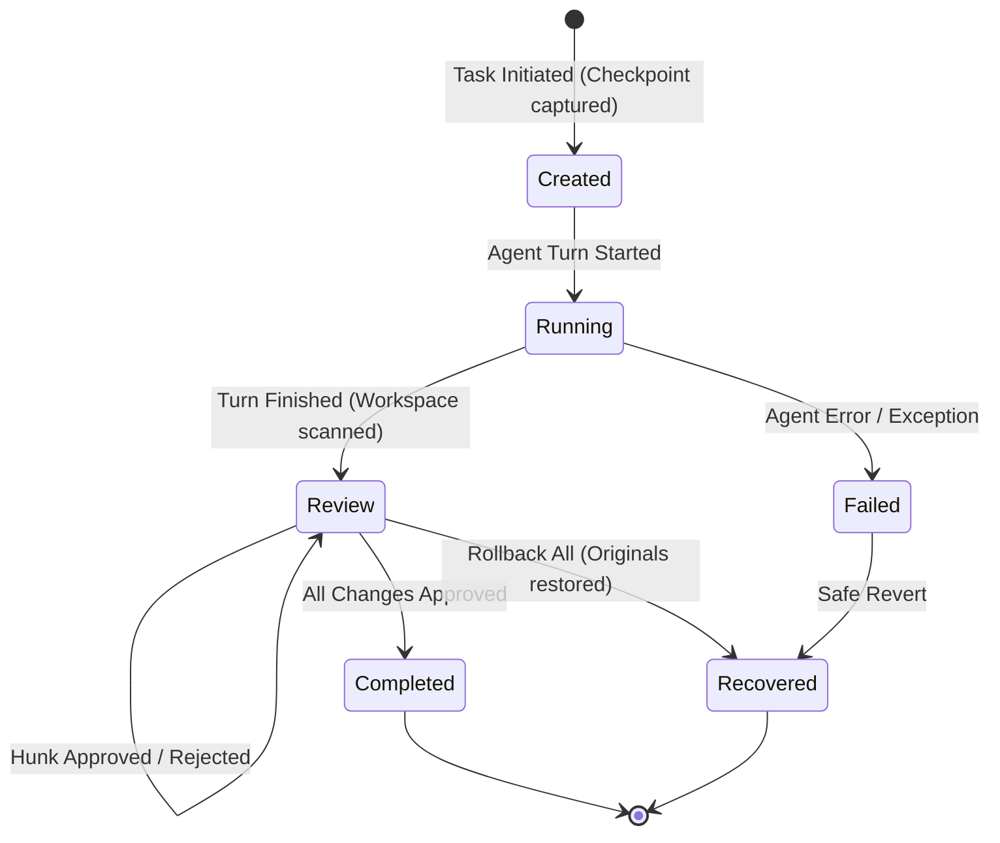

# PATCHVAULT &mdash; System Architecture & Technical Specifications

> &ldquo;AI can write the code. PATCHVAULT makes sure developers never lose control of it.&rdquo;

---

## 1. Division of Responsibility (Non-Negotiable)

```
+-------------------------------------------------------------------+
|                           TRUEFORGE                               |
| (TrueFoundry's open-source agent harness - https://trueforge.dev) |
|                                                                   |
|   - Agent orchestration loop                                      |
|   - LLM model invocation & streaming (Gemini, Claude, GPT, etc.)  |
|   - Tool executions & MCP servers                                 |
|   - Session & turn state management                               |
+-------------------------------------------------------------------+
                                  |
                                  | Server-sent events (SSE)
                                  v
+-------------------------------------------------------------------+
|                          PATCHVAULT                               |
|              (VS Code Extension & Flight Recorder)               |
|                                                                   |
|   - Pre-task git checkpoints (private refs)                       |
|   - Content-addressed SHA-256 original file snapshots            |
|   - Real-time workspace change detection & LCS line diffing       |
|   - Hunk-level review & partial revert                            |
|   - All-or-nothing hash-checked recovery (no git reset/checkout)  |
|   - Fact-based recovery confidence engine                         |
|   - Append-only flight recorder with secret redaction             |
|   - Native SecretStorage for TrueForge credentials                |
+-------------------------------------------------------------------+
```

PATCHVAULT **never** implements its own autonomous agent loop or model prompting. TrueForge handles agent planning and execution, while PATCHVAULT provides the safety flight recorder ensuring developers can review, approve, reject, or recover any modification safely.

---

## 2. Change Capsule Lifecycle & State Machine

Every autonomous coding task runs within an isolated **Change Capsule**:



### 2.1 The Change Capsule Schema (`v1`)
A Change Capsule is stored as a JSON manifest alongside a content-addressed blob directory:
`<globalStorage>/patchvault/capsules/<id>/capsule.json`

Key fields:
- `id`: Unique time-sortable ULID/hex identifier.
- `checkpoint`:
  - `isGitRepo`: Boolean indicating if workspace is in git.
  - `head`: Commit hash at time of checkpoint.
  - `refName`: Private git reference `refs/patchvault/<capsuleId>` created without staging or committing.
  - `stagedFiles`, `unstagedFiles`, `untrackedFiles`: Pristine workspace state snapshot.
- `manifest`: Array of `FileSnapshot` records (`path`, `sha256`, `size`, `blobId`).
- `changes`: Detected file modifications (`kind`, `originalSha256`, `modifiedSha256`, `added`, `removed`, `unifiedDiff`, `hunks`, `review`, `expected`).
- `tests`: Array of test execution runs (`command`, `durationMs`, `exitCode`, `outcome`, `counts`).
- `events`: Append-only flight recorder logs with secret redaction.
- `recoveries`: History of recovery actions (`scope`, `restored`, `conflicts`, `verified`).

---

## 3. Core Engine Components

### 3.1 Checkpoint Manager (`src/core/git/checkpointManager.ts`)
1. **Private Git Reference**: Creates `refs/patchvault/<id>` pointing directly to HEAD using `git update-ref`. This leaves the working tree and index 100% untouched.
2. **Content-Addressed Snapshot**: Copies every workspace file (committed, uncommitted, and untracked, honoring `.gitignore`) into the capsule's `blobs/` directory named by its SHA-256 hash. Files $> 5\text{ MB}$ are excluded.

### 3.2 Unified Diff & Hunk Engine (`src/core/diff/unifiedDiff.ts`)
1. **LCS Diffing**: Pure TypeScript Longest Common Subsequence line diff with zero external dependencies.
2. **Hunk Clustering**: Clusters modifications within 6 lines of each other with 3 context lines, outputting standard unified diff headers (`@@ -oldStart,oldCount +newStart,newCount @@`).
3. **Reconstruction from Hunks**: Allows granular approval or rejection of individual hunks within the same file. Rejecting a hunk reverts that hunk's deletions and omits its additions while keeping approved hunks intact.

### 3.3 Recovery Manager (`src/core/git/recoveryManager.ts`)
- **All-or-Nothing Guarantee**: Before touching any file on disk, PATCHVAULT executes a preflight verification:
  1. Does the current file hash match `modifiedSha256` (the state PATCHVAULT last inspected)?
  2. Is the original blob intact and uncorrupted in the storage?
- If **any** conflict or discrepancy is found (e.g. the developer or another tool edited the file concurrently), recovery **aborts immediately without writing anything**.
- Never uses `git reset --hard` or `git checkout`.
- Atomically replaces files via temporary swap files (`.pv-tmp-<pid>`).
- Re-verifies file hashes on disk immediately after writing.

### 3.4 Recovery Confidence State Engine (`src/core/capsule/capsuleManager.ts`)
No arbitrary confidence percentages. The state is computed from strict verifiable facts:
- **`Protected`**: Original checkpoint captured; no outstanding unreviewed changes.
- **`Needs Review`**: Changes detected that have not been reviewed, or changes occurred outside the agent's planned files.
- **`Recovery Available`**: All changes reviewed; originals verified in storage and ready for safe restoration.
- **`Verification Failed`**: Last test run failed or could not execute.
- **`Recovery Incomplete`**: Original files unavailable, corrupted, or tampered with.

---

## 4. TrueForge Integration & Windows Execution

### 4.1 Windows Limitation
TrueForge server's `LocalSandboxProvider` explicitly validates `process.platform` and supports only macOS (`darwin`) and Linux (`linux`). On Windows (`win32`), local sandbox creation returns:
`LocalSandboxProvider supports macOS and Linux only (got win32)`

### 4.2 Supported Options
1. **WSL 2 Host (Proven & Recommended)**:
   Run the TrueForge server inside WSL (`wsl npx @truefoundry/trueforge@latest`) with the Windows project folder mounted under `/mnt/c/...`. TrueForge runs natively in Linux and edits workspace files in place. PATCHVAULT's workspace scanner detects the edits immediately.
2. **Remote Sandbox / Daytona (Documented)**:
   Using a remote sandbox environment configured in TrueForge settings. Files produced can be downloaded via `client.sessions.downloadSandboxFile(sessionId, turnId, { path })`.
3. **Tool-Call Inspection & Event Sync**:
   The adapter monitors `model.message` streaming events, parses `toolCalls` (e.g. `write_file`, `str_replace_editor`), extracts target file paths into `plannedChanges`, and when `syncRemoteEdits` is enabled, synchronizes edits safely into the workspace using `resolveInside`.
4. **MOCK Adapter (Offline / Testing)**:
   Clearly marked `MOCK (not TrueFoundry)` for testing without live models or credentials.
